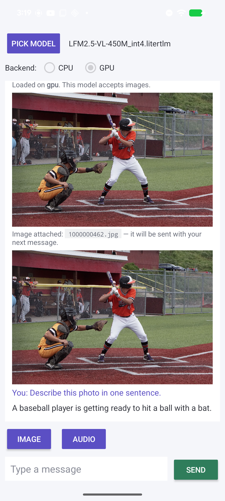

# litertlm-chat-android

A minimal Android chat app for **LiteRT-LM** (`.litertlm`) models — text **and images** — built with the official [`litertlm-android` Maven AAR](https://maven.google.com/web/index.html#com.google.ai.edge.litertlm:litertlm-android) (0.16.0) and Bazel 9.

Why it exists: as of LiteRT-LM 0.16.0 there is no stock way to run **hybrid vision-language `.litertlm` bundles with image input on Android** — the Gallery app does not accept hybrid-architecture imports and the `litert_lm_main` CLI has no image flag. This app fills that gap with ~500 lines of Kotlin: pick any `.litertlm` from storage, pick a backend, attach a photo, chat.

Verified on a Pixel 8a with [litert-community/LFM2.5-VL-450M](https://huggingface.co/litert-community/LFM2.5-VL-450M) (int4, 388 MB): text graph on the **OpenCL GPU**, vision encoder on CPU, streaming answers. The sibling [1.6B](https://huggingface.co/litert-community/LFM2.5-VL-1.6B) and [3B](https://huggingface.co/litert-community/LFM2.5-VL-3B) bundles load the same way.



## Build

Prereqs: Android SDK (API 35, build-tools 35.0.0), NDK **27.3.13750724**, `bazelisk`.

Edit two machine-specific paths in `litert_lm_android_sample_app/MODULE.bazel` (`android_sdk_repository_extension.configure` and `android_ndk_repository_extension.configure`), then:

```bash
cd litert_lm_android_sample_app
bazelisk build //:litertlm_chat \
  --android_platforms=@rules_android//:arm64-v8a \
  --cxxopt=-std=c++17 --host_cxxopt=-std=c++17
adb install -r bazel-bin/litertlm_chat.apk
```

macOS note: if your `xcode-select` points at an Xcode **beta**, bazel host-tool compiles fail with "absolute path inclusion(s)". The committed `.bazelrc` pins `DEVELOPER_DIR` to `/Applications/Xcode.app` for repo rules, target actions AND host actions (`--host_action_env` is the one people miss) — adjust or delete on other setups.

## Usage

1. Push or download a `.litertlm` model to the device (e.g. from [litert-community](https://huggingface.co/litert-community)).
2. **Pick Model** → choose the file (it is copied to the app cache; 400 MB takes a few seconds).
3. Pick **CPU** or **GPU**. The app tries, in order: multimodal on your chosen backend → text-GPU + vision-CPU → multimodal CPU → text-only CPU, and tells you what actually loaded.
4. **Image** → pick a photo → type a question → **Send**.

## Findings baked into the code (the parts that cost time)

- **`audioBackend` must be omitted for bundles without an audio encoder.** Setting `audioBackend = Backend.CPU()` on a vision-only bundle fails conversation creation with `NOT_FOUND: TF_LITE_AUDIO_ENCODER_HW not found in the model` (`ChatEngine.kt`, stage 1 comment).
- **The SigLIP2 vision encoder does not compile on the Pixel GPU delegate** (`vision_litert_compiled_model_executor.cc:247`), while the LFM2.5-VL *text* graph delegates fully to OpenCL (937/937 and 543/543 nodes measured via `litert_lm_main`). Hence the dedicated **text-GPU + vision-CPU** fallback stage — vision is a one-shot per image, so this split costs little.
- `Contents` has no public constructor — use `Contents.of(...)`; `Content.Text` goes **before** `Content.ImageFile`.
- Model/media files must be copied out of `content://` URIs into `cacheDir` with their real display names — the native engine inspects file extensions.

This app was generated by following the `create-litert-lm-android-demo-app` agent skill that ships inside the [LiteRT-LM repository](https://github.com/google-ai-edge/LiteRT-LM) (Maven scenario); `task.md` and the three `compliance_review_*.md` files are that skill's audit trail.

## License

Apache-2.0. Model files are licensed by their publishers (the LFM2.5-VL family is under the LFM Open License v1.0).
