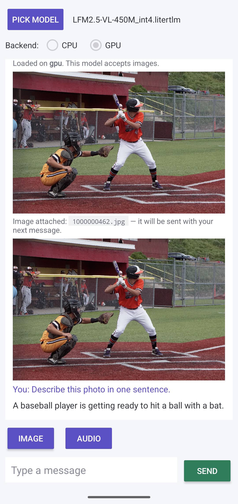

# Details

This page is the earlier README, from 2026-08-13, on `litertlm-android` 0.16.0. The [README](../README.md) has the current summary.

A minimal Android chat app for **LiteRT-LM** (`.litertlm`) models — text **and images** — built with the official [`litertlm-android` Maven AAR](https://maven.google.com/web/index.html#com.google.ai.edge.litertlm:litertlm-android) (0.16.0) and Bazel 9.

The app is ~500 lines of Kotlin: pick any `.litertlm` from storage, pick a backend, attach a photo, chat.

Verified on a Pixel 8a across six models from [litert-community](https://huggingface.co/litert-community) — see the table below. For the LFM2.5-VL family the text graph runs on the **OpenCL GPU** with the vision encoder on CPU, streaming answers.



## Verified models (Pixel 8a, this app, 2026-08-13)

| Model (litert-community) | Size | Load result | Sample answer |
|---|---|---|---|
| LFM2.5-VL-450M int4 | 407 MB | **gpu** (text-GPU + vision-CPU) | "A baseball player is getting ready to hit a ball with a bat." |
| LFM2.5-VL-1.6B int4 | 1.3 GB | **gpu** (text-GPU + vision-CPU) | "A baseball player is getting ready to swing his bat." |
| FastVLM-0.5B | 1.16 GB | **gpu** | "A baseball player in an orange and white uniform … is poised to swing at a pitch, while a catcher … crouches behind him." |
| SmolVLM2-500M | 361 MB | **gpu** | "A baseball player in a red uniform is swinging at a ball while a catcher in a yellow uniform watches." |
| PaddleOCR-VL-1.6 | 1.39 GB | **gpu** | Sign OCR, all three lines: "CLOSED BACK AT 3 PM" |
| Qwen2-VL-2B | 1.78 GB | process killed during engine init on BOTH backends (app memory budget on the 8 GB device; the CLI-measured numbers on its card are unaffected) | — |
| LFM2.5-VL-3B int4 | 2.35 GB | not verified in-app: the test device's storage manager kept evicting the file at 97%+ disk. Budget ~2× the file size free (the app copies models to its cache) | — |

Notes: "gpu" is what the cascade actually loaded (the vision encoder runs on CPU for the LFM2.5-VL family — see Findings). Every model above was driven through the exact same flow: file picker → backend radio → photo attach → prompt.

## Build

Prereqs: Android SDK (API 35, build-tools 35.0.0), NDK **27.3.13750724**, `bazelisk`.

Edit two machine-specific paths in `litert_lm_android_sample_app/MODULE.bazel` (`android_sdk_repository_extension.configure` and `android_ndk_repository_extension.configure`), then:

```bash
cd litert_lm_android_sample_app
bazelisk build //:litertlm_chat \
  --android_platforms=@rules_android//:arm64-v8a \
  --cxxopt=-std=c++17 --host_cxxopt=-std=c++17
adb install -r bazel-bin/litertlm_chat.apk
```

macOS note: if your `xcode-select` points at an Xcode **beta**, bazel host-tool compiles fail with "absolute path inclusion(s)". The committed `.bazelrc` pins `DEVELOPER_DIR` to `/Applications/Xcode.app/Contents/Developer` for repo rules, target actions AND host actions (`--host_action_env` is the one people miss) — adjust or delete on other setups.

## Findings baked into the code (the parts that cost time)

- **`audioBackend` must be omitted for bundles without an audio encoder.** Setting `audioBackend = Backend.CPU()` on a vision-only bundle fails conversation creation with `NOT_FOUND: TF_LITE_AUDIO_ENCODER_HW not found in the model` (`ChatEngine.kt`, stage 1 comment).
- **The SigLIP2 vision encoder does not compile on the Pixel GPU delegate** (`vision_litert_compiled_model_executor.cc:247`), while the LFM2.5-VL *text* graph delegates fully to OpenCL (937/937 and 543/543 nodes measured via `litert_lm_main`). Hence the dedicated **text-GPU + vision-CPU** fallback stage — vision is a one-shot per image, so this split costs little.
- `Contents` has no public constructor — use `Contents.of(...)`; `Content.Text` goes **before** `Content.ImageFile`.
- Model/media files must be copied out of `content://` URIs into `cacheDir` with their real display names — the native engine inspects file extensions.

This app was generated by following the `create-litert-lm-android-demo-app` agent skill that ships inside the [LiteRT-LM repository](https://github.com/google-ai-edge/LiteRT-LM) (Maven scenario); `task.md` and the three `compliance_review_*.md` files are that skill's audit trail.

## Backend fallback

The app tries, in order: multimodal on your chosen backend → text-GPU + vision-CPU → multimodal CPU → text-only CPU, and tells you what actually loaded.
